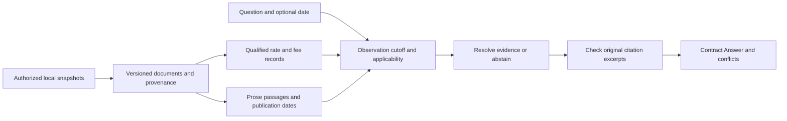

# Temporal credit-union knowledge

A local knowledge system for answering questions from dated website snapshots.
It preserves financial product qualifiers, distinguishes observation time from
effective time, cites original evidence, and declines unsupported answers.

The submission uses **Python's standard library only**: no keys, model downloads,
external services, or live website calls. The required `build()` entry point is
in the repository root, outside `starter/`.



## Setup and data

Python 3.9 or newer is required; the assignment's grading environment is Python
3.11. Create an environment and install the empty dependency manifest:

```bash
python3 -m venv .venv
source .venv/bin/activate
python -m pip install -r requirements.txt
python -m unittest discover -s tests -v
```

**The supplied website is not redistributed.** Obtain the original participant
kit through the organizers. Keep it outside this public checkout, for example:

```text
workspace/
  temporal-knowledge/       # this repository
  participant-kit/          # authorized original kit, never committed
    snapshots_zip/
    snapshots/
    harness/
    eval/
```

The CLI reads either the original ZIP directory directly, without extraction,
or the extracted snapshot directories containing `manifest.json` and `pages/`.
It never uses filesystem modification times. Archive and manifest paths must
remain inside their snapshot.

## Ask questions

```bash
python -m knowledge --snapshots ../participant-kit/snapshots_zip \
  'What is the 6-month certificate APY?'

python -m knowledge --snapshots ../participant-kit/snapshots_zip \
  --as-of 2026-05-31 'What is the 10-month jumbo certificate APY?'

python -m knowledge --snapshots ../participant-kit/snapshots_zip --conflicts
```

The CLI emits JSON containing `text`, `sources`, `confident`, and `conflict_note`.
Errors go to stderr. Each invocation builds an in-memory index; the official
scorer ingests once and reuses the same object for all questions.

`build()` returns an object with the exact required methods:

```python
from solution import build

system = build()
for snapshot in snapshots:          # official Snapshot objects, oldest first
    system.ingest(snapshot)
answer = system.answer(question, as_of=None)
conflicts = system.conflicts()
```

Our dataclasses mirror the supplied boundary schema; the official scorer
explicitly supports this form. No private harness import is needed at runtime.

## Reproduce the official evaluation

Run the organizer's unchanged scorer from an authorized kit:

```bash
python scripts/evaluate.py --kit ../participant-kit --out results/public
```

If developing inside the original kit, the equivalent direct command is:

```bash
python harness/run_eval.py --submission . \
  --eval eval/public_eval.jsonl --out results/public
```

The scorer unpacks its own ZIPs when necessary. Neither command modifies the
scorer or reference answers. The optional external model judge is disabled.
Raw per-question outputs contain private source text and remain ignored.
Verified results, category breakdowns, failure analysis, and reference-answer
limitations are recorded in [docs/evaluation.md](docs/evaluation.md).

## How evidence is selected

Financial tables become product/term/tier/metric records linked to their raw
source. Personal versus business, IRA versus non-IRA, standard versus jumbo,
vehicle years, loan purpose, and APR versus APY remain distinct. Ordinary
product names and aliases are discovered from the data. Prose retrieval uses
token weighting plus explicit entity and topic applicability checks.

Historical answers first exclude evidence not observed by the cutoff. Explicit
effective dates and expired offers then constrain applicability. Operative rate
tables outrank illustrative calculators and archived marketing, as the official
assignment requires. Different source URLs with equally applicable conflicting
values cause refusal. The system preserves omitted financial observations;
an omitted promotion has uncertain current applicability rather than an
invented discontinuation date.

Answers cite original URLs, snapshot IDs, and verbatim excerpts. Before an
answer leaves the engine, its excerpts are checked against that exact observed
document. The original synthetic tests also check selected values and tiers.
Unknown named products do not inherit nearby products' rates, and unsupported
dates or missing reporting periods produce `confident=False`.

## Engineering notes and limits

- In-memory storage fits this corpus and avoids database deployment or private
  persistent indexes. Nothing leaves the machine.
- Deterministic extraction makes decisions inspectable and fast. It has bounded
  paraphrase and layout coverage; it does not implement general semantic
  reasoning, arbitrary calculations, or unrestricted multi-hop answers.
- Financial changes can be compared using explicit ISO dates or named
  month/year periods. Historical “as of” supports ISO dates and named-month
  requests. Date inference deliberately avoids guessing arbitrary periods.
- Conflict detection covers qualified financial records and selected prose
  counts, not every possible contradiction in natural language. No real-data
  conflict gold is included in the public kit.
- General branch hours are labeled published examples and qualified by branch;
  the system does not claim live opening status or extrapolate beyond the data.
- Synthetic policy tests and public practice scores are complementary evidence,
  not a guarantee of hidden-test performance.

Read [NOTES.md](NOTES.md) for the short submission summary,
[docs/architecture.md](docs/architecture.md) for decisions and the requirement
map, and [docs/interview.md](docs/interview.md) for the technical briefing.

## Verification and publication hygiene

```bash
python -m unittest discover -s tests -v
python -m compileall -q solution.py knowledge scripts tests
python scripts/check_public_tree.py
python scripts/benchmark.py --snapshots ../participant-kit/snapshots_zip \
  --questions ../participant-kit/eval/public_eval.jsonl
```

CI is configured to run the original synthetic tests on Python 3.9, 3.11, and
3.13; official practice evaluation requires the separately supplied private kit.
The Git audit checks tracked paths, reachable history, and common secret
patterns. It complements manual inspection and does not claim to detect every
possible secret. Do not commit original inputs, derived indexes, or raw results.

No public remote is configured by the implementation. Publishing the repository
and sending the submission email remain separate owner actions after review.
